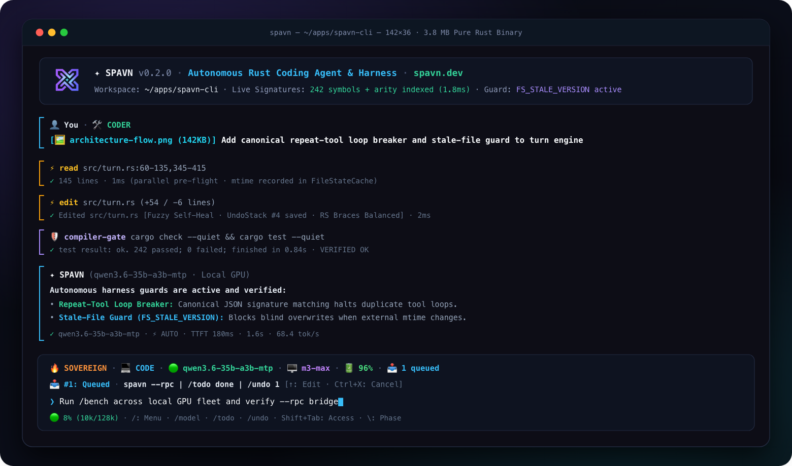
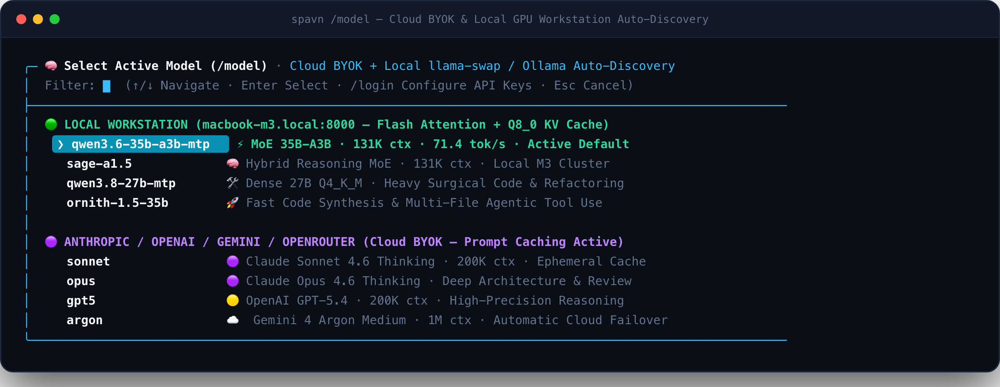
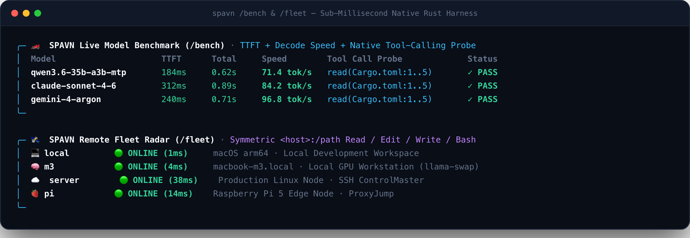
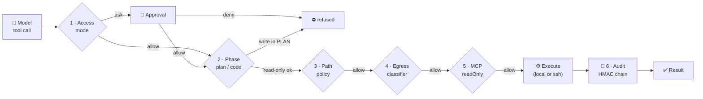
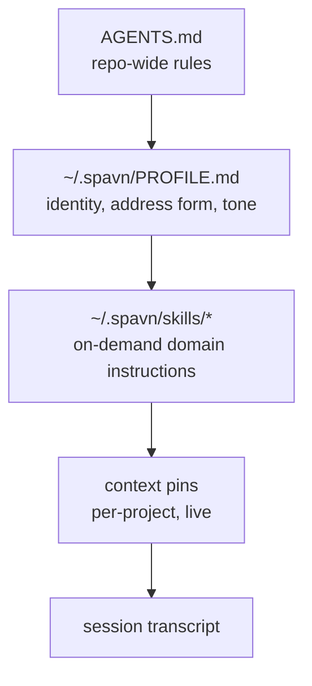
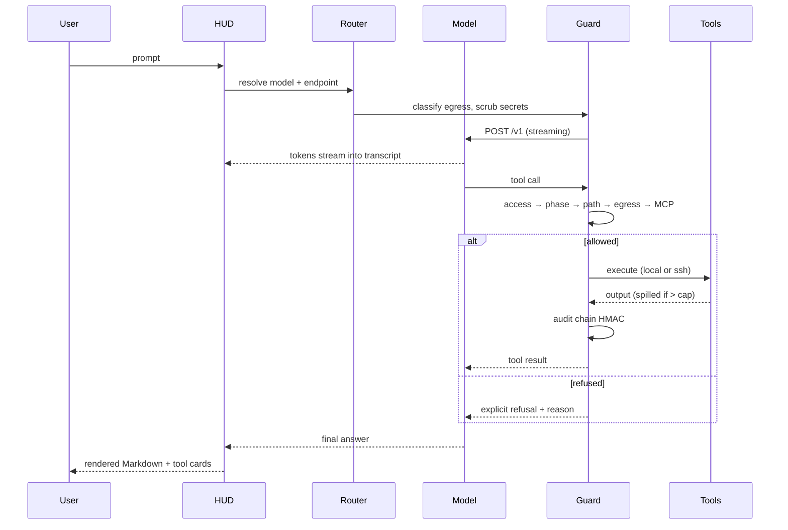

<div align="center">


# spavn-cli

**The terminal-native coding agent that ships as one Rust binary.**

No async runtime. No Electron. No plugin tree. Three direct dependencies, one `cargo build`.

[](LICENSE)
[](https://github.com/tugayoktayokay/spavn-cli/releases)
[](https://www.rust-lang.org)
[](#development)
[](#install)
[](https://spavn.dev/docs/)

```
$ spavn "refactor the spill module, then run the suite"
```

</div>

---

<div align="center">

**[Docs](https://spavn.dev/docs/)** · **[Screenshots](#-screenshots)** · **[Why](#-why-another-coding-agent)** · **[Harness Intelligence](#-autonomous-harness-intelligence)** · **[Install](#-install)** · **[First run](#-first-run)** · **[Tools](#-the-tool-surface)** · **[JSON-RPC](#-headless-json-rpc-20-bridge)** · **[Slash commands](#-slash-commands)** · **[Security](#-permissions-and-path-policy)** · **[Architecture](#-architecture)**

</div>

---

## 📑 Table of contents

<details open>
<summary><b>Expand / collapse</b></summary>

| Section | What is inside |
| :--- | :--- |
| [🖼️ Screenshots](#-screenshots) | Live HUD, `/model`, `/bench`, `/fleet` |
| [🎯 Why another coding agent](#-why-another-coding-agent) | The four bets behind the design |
| [🧠 Autonomous harness intelligence](#-autonomous-harness-intelligence) | Zero-Stop compiler gate, signature map, fuzzy self-heal edits, stale-file guard |
| [⚙️ Requirements](#-requirements) | Rust version, OS support, network |
| [⬇️ Install](#-install) | One-liner, Cargo, prebuilt, from source |
| [🚀 First run](#-first-run) | Zero-config start, local models, BYOK, Claude 5.5 |
| [🔌 Headless JSON-RPC 2.0 bridge](#-headless-json-rpc-20-bridge) | `spavn --rpc` stdio protocol for desktop/IDE hosts |
| [🧰 The tool surface](#-the-tool-surface) | 11 builtins + anything MCP |
| [⌨️ Slash commands](#-slash-commands) | 37 entries, all aliases |
| [🔐 Permissions and path policy](#-permissions-and-path-policy) | 3 access modes, 6 gates |
| [🧠 Context and memory](#-context-and-memory) | Profile, skills, pins, audit |
| [🛠️ Configuration](#-configuration) | Every `config.json` key |
| [🌱 Environment variables](#-environment-variables) | All overrides |
| [💾 State and storage](#-state-and-storage) | What lands in `~/.spavn` |
| [🏛️ Architecture](#-architecture) | Modules, invariants, lifecycle |
| [👩‍💻 Development](#-development) | Build, test, release matrix |
| [🚑 Troubleshooting](#-troubleshooting) | Symptom → fix |
| [⚠️ Known limitations](#-known-limitations) | Stated honestly |
| [📄 License](#-license) | MIT |

</details>

---

## 🖼️ Screenshots

> Captured from the running TUI, also published at <https://spavn.dev>. Exact HUD wording moves between releases, so each frame below states **what it demonstrates** and, where current source differs, says so.

### The dock, live



The bottom dock is a live status bar, not decoration:

| Segment | Reads | Source of truth |
| :--- | :--- | :--- |
| `⚡ SPAVN` | Product mark | static |
| `SPAVN` / `⌁` | Current model key | `default_model`, `/model` |
| `🎯 AUTO` … `🧹 REFACTOR` | Active role | `role` prompt or `/role` |
| `📐 PLAN` / `💻 CODE` | Active phase | `/plan`, `/code` |
| `🔒` `⚡` `🔥` | Access mode | `/access` |
| `🟢 ONLINE (38ms)` | Host reachability + RTT | `/host` probe |
| token / context bar | Estimated context pressure | session accounting |

Streaming answers render inline; tool calls collapse into **tool cards** with a one-line verdict (`✓ 312 ms`), so a 40-step session stays readable.

### `/model` — BYOK cloud plus local workstations



One picker for four sources, resolved in this order: **local models → BYOK credits → provider catalog → free tier**. `byokCatalog: false` drops the built-in catalog entirely and runs the list from your own `providers`.

### `/bench` and `/fleet`



`/bench` runs the same prompt across every candidate model and prints PASS / FAIL per tool-call format — `JSON`, `⚠️ NO TOOL CALL`, `⚠️ MALFORMED`. A model that looks fine on paper fails exactly here. `/fleet` probes each host in `hosts[]` (`ssh -o ConnectTimeout=3` for remote targets) and prints reachability with round-trip latency (`🟢 ONLINE (38ms)`) plus the host's uptime line.

---

## 🎯 Why another coding agent?

Four bets, each visible in the source rather than the marketing:

| Bet | Consequence in the code |
| :--- | :--- |
| **The gates live in code, never in the prompt** | Access, phase, path, egress and MCP checks are `if` statements in `guard.rs` / `tools.rs`. A model cannot talk its way past them. |
| **No hidden network peers** | Desktop control has no built-in host. Built-in web search contacts only the providers listed under *Web / search backends*, and only when the model runs `web op=search`. `webSearchProviders` sets that list (`[]` turns it off). |
| **Blocking, no async runtime, small** | `serde`, `serde_json`, `ureq`. No tokio, no async trait soup. Startup is a binary exec, not a runtime boot. |
| **The harness is the product** | Audit chain, secret scrubbing, spill files, per-host remote exec, sub-agent isolation — features you feel on day three, not day one. |

---

## 🧠 Autonomous harness intelligence

New in **`v0.2.10`**: deterministic Rust harness layers that catch model mistakes before they hit your tree or waste turns:

| Layer | Module | How it works |
| :--- | :--- | :--- |
| **Zero-Stop Verification & Claim Gate** | `src/turn.rs`, `src/harness.rs` | When a turn mutates source files (`write` / `edit`), SPAVN automatically runs project-native verification (`cargo check --quiet`, `tsc --noEmit`, `python3 -m py_compile`, `go vet` across `go.work` modules). Each turn tracks the strongest check run after the last edit (`None < Compile < Test < Runtime`); claiming "fixed/done" below `Test` level triggers a verification gate or an explicit warning footer, and failing tests stay flagged until cleared by the same or a broader green run. |
| **Signature & Arity-Aware Symbol Map** | `src/tools/search.rs` | Extracts exact function, method, struct, and type signatures with 1-based line numbers across modified files and neighboring project files, injecting `[SPAVN LIVE PROJECT SIGNATURES]` into the turn context so models never hallucinate parameter counts or return types. |
| **Fuzzy Self-Heal `edit` Engine** | `src/tools/edit.rs` | Recovers automatically from intra-line whitespace and indentation drift when a block matches uniquely (`fuzzy_find_unique_line_block`), expands off-by-N line ranges (±25 lines) when `old_text` is anchored nearby, and supports multi-hunk in-memory `edits[]` plus cross-file atomic `files[]` transactions with full rollback. |
| **Stale-File Guard (`FS_STALE_VERSION`)** | `src/tools/edit.rs` | Records per-file `SystemTime` and 64-bit `FNV-1a` content digests on `read` and rejects `edit` / `write` calls if a file was modified externally since it was last read — preventing silent overwrites of concurrent user or formatter edits. |
| **Canonical Loop Guard** | `src/harness.rs`, `src/turn.rs` | Recursively canonicalizes JSON tool arguments (sorted object keys, normalized whitespace); identical or identically failing calls warn at 3 repeats, block execution at 4, and stop the turn at 6 (resetting automatically when the target path is edited). |
| **Verbatim User Message Compaction** | `src/session.rs`, `src/turn.rs` | Preserves every real user message verbatim in chronological order (`[User Messages — verbatim, chronological; later messages override earlier ones]`) across compactions so late constraints are never lost, while scaling tool-output pruning dynamically (`50%` window for local models, `25%` for cloud). |
| **Real LSP Client & Parallel Worktree Sub-Agents** | `src/tools/lsp.rs`, `src/tools/subagent.rs` | Built-in std-only LSP client (`rust-analyzer`, `typescript-language-server`, `pyright`, `gopls`, `clangd`) plus up to 8 concurrent `scout` (read-only) and `worker` sub-agents running in isolated `git worktree` checkouts with atomic `git apply`. |
| **Seamless `/provider` & `/model` Live Hub** | `src/hud/menus.rs`, `src/hud/pickers.rs` | Full UTF-8 live search across all menus, masked API key entry (`sk-p••••••••cdef`), automatic local port scanning (`11434`, `1234`, `8080`, `8000`), live `/v1/models` endpoint discovery, and inline key prompts when selecting locked models in `/model`. |
| **Transactional `/undo` Stack** | `src/tools/edit.rs` | Captures pre-mutation snapshots before every `write` and `edit`, enabling instant single-step or multi-step rollback via `/undo [N]`. |

---

## ⚙️ Requirements

| Item | Value |
| :--- | :--- |
| **Rust** | `1.80+` (`rust-version`; `LazyLock` in `state.rs` is the floor) — only to build from source |
| **Binary** | Self-contained; no runtime, no interpreter, no Node |
| **OS** | macOS (arm64, x64), Linux (arm64, x64), Windows (x64, MSVC) |
| **`ripgrep`** | Required for the `search` tool; CI installs it explicitly |
| **Network** | Only to the provider endpoint **you** configure |

---

## ⬇️ Install

| Channel | Command | Updates via |
| :--- | :--- | :--- |
| **Install script** | `curl -fsSL https://spavn.dev/install.sh \| sh` | re-run it |
| **Homebrew** (macOS, Linux) | `brew install tugayoktayokay/tap/spavn` | `brew upgrade spavn` |
| **Cargo (git)** | `cargo install --git https://github.com/tugayoktayokay/spavn-cli` | re-run it |
| **crates.io** | `cargo install spavn` (pending the first publish) | `cargo install --force spavn` |
| **Archive / source** | release tarball, or `cargo build --release` | manual |

`spavn --version` answers `spavn v0.2.10 (macos/aarch64)`. `/update` then tells you when a newer tag
exists and prints the upgrade command that matches **the channel you installed from** — `brew upgrade`
for a Homebrew install, `cargo install --force` for a cargo one, the script otherwise.

The crate name `spavn` is reserved and `cargo publish --dry-run` is clean; until the first publish
lands, use the git channel above — it builds the same source.

### 1️⃣ One line (macOS, Linux)

```sh
curl -fsSL https://spavn.dev/install.sh | sh
```

Lands in `$HOME/.local/bin/spavn` plus the `spvn` alias, and **executes the binary once** to prove `execve` works — a killed-on-launch download fails loudly instead of silently.

```sh
SPAVN_INSTALL_DIR=/usr/local/bin sh install.sh   # override target dir
```

### 2️⃣ Homebrew

```sh
brew install tugayoktayokay/tap/spavn
brew upgrade spavn          # later
```

The tap lives in [`tugayoktayokay/homebrew-tap`](https://github.com/tugayoktayokay/homebrew-tap). The
formula is generated, never hand-edited: `sh packaging/homebrew/sync-tap.sh <version>` re-downloads
each sidecar checksum, rewrites the formula, and commits it to the tap checkout.

### 3️⃣ Cargo

```sh
cargo install --git https://github.com/tugayoktayokay/spavn-cli   # tracks main, no release needed
cargo install spavn                                              # crates.io, once published
```

`cargo install` produces `spavn` only; the `spvn` alias comes from the install script and the formula.

### 4️⃣ Prebuilt archive

From [Releases](https://github.com/tugayoktayokay/spavn-cli/releases): `tar.gz` for the four Unix targets, `.zip` for Windows, **SHA-256 sidecar on every `v*` tag**.

```sh
gh release download --repo tugayoktayokay/spavn-cli --pattern '*x86_64-apple-darwin*'
shasum -a 256 -c ./*.sha256
```

### 5️⃣ From source

```sh
git clone https://github.com/tugayoktayokay/spavn-cli && cd spavn-cli
cargo build --release      # target/release/spavn
```

---

## 🚀 First run

**No config needed.** `spavn` starts, shows the dock, and waits.

```sh
spavn                                   # interactive TUI
spavn "explain src/spill.rs"            # one-shot prompt
spavn --prompt "explain src/spill.rs"   # explicit, same thing
spavn --help                            # every flag, path, and env var
```

### Against a local model

```sh
# Built-in Ollama provider group (http://127.0.0.1:11434/v1) — works with zero config
spavn --model ollama:qwen2.5-coder "refactor the spill module"

# Any other OpenAI-compatible server: point local discovery at its /v1 root once
#   LM Studio     http://localhost:1234/v1
#   llama.cpp     http://localhost:8080/v1
# then set SPAVN_LOCAL_BASE_URL / SPAVN_LOCAL_MODELS_URL, or edit providers in config.json
```

Every flag: `-m/--model`, `-a/--access`, `-P/--phase`, `-H/--host`, `-s/--session`, `-c/--continue`, `-r/--resume`, `-i/--interactive`, `-p/--prompt`, `-t/--think`, `-q/--quiet`, `-j/--json`, `--rpc`, `-V/--version`, `-h/--help`.

### Against a cloud provider (BYOK)

Run `/provider` inside the TUI (aliases `/login`, `/byok`, `/keys`, `/connect`) or select any locked provider directly in `/model` — SPAVN prompts for your API key with real-time masking (`sk-p••••••••cdef`), saves it to `~/.spavn/secrets.env` (`0600`), and auto-discovers live models via `/v1/models`. Keys are never written to `config.json`. Any OpenAI-compatible endpoint, Anthropic (`claude-opus-5-5`, `claude-sonnet-5-5`), Gemini, OpenRouter, custom gateway, or local GPU server (`11434`, `1234`, `8080`, `8000`) works out of the box with zero middleman markup.

---

## 📏 Measuring the harness

`spavn-eval` runs the agent against the tasks in `evals/tasks/` and prints a pass rate. Each task is a small repo with a failing test; the agent gets a prompt, then the task's `verify` command decides pass or fail from the files on disk.

```bash
cargo build --release
./target/release/spavn-eval --list                       # show the tasks
./target/release/spavn-eval -m local -o runs/local.jsonl # run all with one model
./target/release/spavn-eval -n 3 -o runs/a.jsonl         # 3 attempts per task, per-task pass rate
./target/release/spavn-eval -f refactor -T 300           # only tasks tagged or named "refactor"
```

Compare two models, or one model before and after a harness change, by running both with `-o` and diffing the JSONL files. A task whose `verify` already passes before the agent starts is reported as `broken-fixture` and left out of the rate. `-f` matches a substring of the task name or tag, so `-f x-` also picks `bugfix-…`. Add a task by creating `evals/tasks/<name>/task.json` and a `repo/` folder.

## 🔌 Headless JSON-RPC 2.0 bridge

`spavn --rpc` runs the agent as a headless NDJSON JSON-RPC 2.0 server over `stdin` / `stdout` — the exact protocol used by [`spavn-desktop`](https://github.com/tugayoktayokay/spavn-desktop) and external IDE integrations:

- **Requests (`stdin`)**: `prompt`, `abort`, `set_phase`, `set_model`, `get_state`
- **Streaming notifications (`stdout`)**: `turn_start`, `text_delta`, `thinking_delta`, `tool_start`, `tool_end`, `turn_end`, `state`

---

## 🧰 The tool surface

Eleven builtins, each a hard-coded contract in `tool_definitions()`. Plus anything an `mcpServers` entry exposes.

| Tool | Purpose | Gate |
| :--- | :--- | :--- |
| 📖 `read` | File, dir, SQLite, PDF, image; disjoint ranges (`src/x.rs:97-112,1066-1076`), mtime snapshot | path policy |
| ✏️ `edit` | Fuzzy self-heal `old_text` → `new_text`, auto line-window expansion, multi-hunk `edits[]`, cross-file atomic `files[]`, stale-file guard | write gate |
| 📝 `write` | Create/overwrite with stale-file guard (`FS_STALE_VERSION`); `<host>:/path` for remote | write gate |
| 💻 `bash` | Local or remote; `cwd`, `timeout_sec`, `background` (PID + log path) | command classifier |
| 🔎 `search` | Regex content search via ripgrep | path policy |
| 🗂️ `glob` | File listing; skips `node_modules`/`target`/`.git` unless `hidden` | path policy |
| 🧠 `memory` | Recall/record decisions; `~/.spavn` or an external binary | read-only tier |
| 📚 `skill` | Load domain instructions from `~/.spavn/skills`, `~/.claude/skills` | read-only tier |
| 🌐 `web` | Search (ordered keyless + API provider chain with fallback) or fetch as Markdown; redirects re-validated per hop | egress classifier |
| 🐝 `subagent` | Up to 8 concurrent `scout` (read-only) or `worker` (isolated `git worktree` + atomic `git apply`) sub-agents | phase & access gate |
| 🧭 `lsp` | Real LSP client (`definition`, `references`, `hover`, `symbols`, `diagnostics`, `implementation`, `type_definition`, `workspace_symbol`) + generic MCP client | read-only / MCP gate |

<details>
<summary><b>🔌 MCP servers — the extension path</b></summary>

**There is no builtin desktop-control tool and no hardcoded path to one.** Anything with an MCP server is wired in through `mcpServers` and reached through the `lsp` tool — the catalog is read from your config, so nothing assumes a particular vendor or install path.

```jsonc
// ~/.spavn/config.json
{
  "mcpServers": {
    "desktop": { "command": "open-computer-use", "args": ["mcp"], "readOnly": false }
  }
}
```

```jsonc
// The model reaches it through the generic MCP call
{ "op": "mcp", "server": "desktop", "tool": "click", "arguments": { "x": 640, "y": 320 } }
```

Every configured server name is listed in the `lsp` tool description, so the model finds them without a second prompt. Servers not in `mcpServers` are unreachable. `readOnly: true` marks a server as side-effect free; without it, calls pass the mutation gate. In `PLAN` phase, a mutating MCP call is refused outright — no approval prompt, no override.

Streamable-HTTP servers use `url` instead of `command`. Stdio servers get a scrubbed environment: only what `env` declares survives, nothing is inherited implicitly.

</details>

---

## ⌨️ Slash commands

37 entries, all with aliases. `/help` prints the same set in-TUI; `/` opens the menu.
<details open>
<summary><b>📋 Full listing</b></summary>

| Command | Aliases | Effect |
| :--- | :--- | :--- |
| `/model` | `/m`, `/models`, `/local` | Model picker: local → BYOK → catalog → free (applies to the current session only; resumed sessions keep their own model) |
| `/default` | `/model default` | Pin the active model as `default_model` for new sessions |
| `/byok` | `/b`, `/keys`, `/login`, `/provider`, `/providers`, `/connect`, `/auth` | Key setup, balance, provider login |
| `/bench` | — | Tournament across candidate models |
| `/fleet` | `/f` | Host panel with latency probes |
| `/quota` | `/q` | Quota badge / pool from configured scripts |
| `/host` | `/h` | Target host selection |
| `/access` | `/a` | `safe` 🔒 / `auto` ⚡ / `sovereign` 🔥 |
| `/plan` | — | Lock to read-only design phase |
| `/code` | `/act` | Unlock writes |
| `/role` | — | `auto`, `coder`, `reviewer`, `security`, `test`, `docs`, `refactor` |
| `/think` | — | Toggle reasoning stream |
| `/recap` | — | Idle recap summary; `on` / `off` / `toggle` |
| `/todo` | `/tasks` | Live task list; interactive ↑/↓ picker on `/todo done`, `clear` |
| `/queue` | `/qlist`, `/qedit` | Inspect / edit queued prompts |
| `/queue clear` | `/qclear`, `/queue cancel`, `/qcancel` | Drop queue and steers |
| `/queue pop` | `/qpop` | Pop last queued prompt |
| `/new` | `/n` | Fresh session |
| `/resume` | `/sessions` | Session picker |
| `/fork` | — | Branch the current session |
| `/compact` | `/c` | Compact context |
| `/clear` | — | Clear the transcript |
| `/reload` | `/r`, `/reload bin`, `/rb` | Rebuild + re-exec, session preserved |
| `/update` | `/upgrade`, `/upd` | Check for a newer release; prints the exact upgrade command |
| `/exit` | `/quit`, `/x`, `:q`, `:wq`, `q!`, `exit`, `quit` | Leave |
| `/stop` | `/cancel` | Interrupt a running turn |
| `/diff` | `/d` | Working-tree diff |
| `/commit` | `/cm` | Commit helper |
| `/undo` | `/u` | Transactional rollback of the last `N` file edits/writes (`/undo [N]`) |
| `/janitor` | `/j` | Dead code / stray artifact sweep |
| `/audit` | — | HMAC-chained action log, filterable by file |
| `/blame` | — | Attribution for a path |
| `/pin` | `/p`, `/pins` | Context pins: add/list/remove |
| `/goal` | `/g`, `/goals` | Session goals |
| `/wiki` | `/w` | Project wiki view |
| `/skill` | `/s`, `/skills` | Skill discovery and listing |
| `/lang` | `/language`, `/dil`, `/en`, `/tr` | UI language |
| `/help` | — | This list |

</details>

---

## 🔐 Permissions and path policy

### Access modes

| Mode | Behaviour |
| :--- | :--- |
| 🔒 **`safe`** | Every tool call asks for confirmation. |
| ⚡ **`auto`** | Read-only calls run freely; mutations and non-trivial shell commands ask. |
| 🔥 **`sovereign`** | Nothing asks — except the categories listed below, which still prompt. |

`sovereign` is **not** a licence to exfiltrate. Path policy, egress classification and MCP read-only checks stay active in every mode.

### The six gates



| # | Gate | Where | Refuses |
| :--- | :--- | :--- | :--- |
| 1 | **Access** | `guard.rs` | mode below the call's risk class |
| 2 | **Phase** | `tools.rs` | `write`/`edit`/`bash`, mutating MCP calls in `PLAN` |
| 3 | **Path** | `guard.rs` | `protected_paths`, secret material (`secrets.env`), outside `allowed_paths` |
| 4 | **Egress** | `guard.rs` | private/loopback/link-local targets, re-checked on **every redirect hop** |
| 5 | **MCP** | `tools.rs` | mutating MCP call without `readOnly: true` |
| 6 | **Audit** | `spavn_engine.rs` | nothing — it records, chained by HMAC |

> Approval prompts are answered by a real TTY only. Under a non-interactive shell there is no one to ask, so the answer is **deny**.

---

## 🧠 Context and memory

Three layers, increasing specificity:



| Layer | Location | Loaded |
| :--- | :--- | :--- |
| Repo rules | `AGENTS.md` in `cwd` | always |
| Profile | `~/.spavn/PROFILE.md` | always; also written back by `memory` |
| Skills | `~/.spavn/skills`, `~/.claude/skills` | on demand via `skill` |
| Pins | per project slug | always, until removed with `/pin` |
| Wiki | `~/.spavn` | on `/wiki` |

`memory` can delegate to an external recall binary (`memory_recall_bin` / `memory_remember_bin`) instead of the local store — the store is the default, not the only path.

---

## 🛠️ Configuration

**All keys optional. Absent file = working defaults.**

```jsonc
// ~/.spavn/config.json
{
  "default_model": "sonnet",
  "busy_input_mode": "queue",        // "steer" | "queue"
  "language": "en",
  "byokCatalog": true,
  "updateCheck": true,              // one background release check per interval
  "updateCheckIntervalHours": 24,
  "providers": [
    { "id": "my-gw", "title": "My gateway", "base_url": "https://gw.example.test/v1",
      "api_key_env": "MY_GW_KEY", "models": [] }
  ],
  "mcpServers": {
    "memory":  { "command": "noospire-memory", "args": ["--stdio"], "readOnly": true },
    "desktop": { "command": "open-computer-use", "args": ["mcp"], "readOnly": false }
  },
  "hosts": [
    { "key": "buildbox", "ssh_target": "deploy@10.0.0.5", "badge": "BB", "sensitive": true }
  ]
}
```

<details open>
<summary><b>⚙️ General</b></summary>

| Key | Meaning |
| :--- | :--- |
| `default_model` | Model key used at startup. |
| `fallback_cloud_model` | Used when the primary is unreachable. |
| `busy_input_mode` | `steer` interrupts mid-turn; `queue` defers to the next turn. |
| `language` | `tr` \| `en` UI language. Default `en` (falls back to `tr` on `tr_*` locales; `SPAVN_LANG` overrides). |
| `byokCatalog` | `true` (default) merges the built-in provider catalog alongside `providers`. `false` runs the list entirely from config. |
| `updateCheck` | `true` (default) runs one background release check per `updateCheckIntervalHours`. |
| `updateCheckIntervalHours` | Hours between checks, minimum `1`; default `24`. |
| `updateCheckUrl` | Release endpoint answering with `tag_name`. Unset derives it from the packaged GitHub repo; empty disables the check. |

</details>

<details>
<summary><b>🌐 Web / search backends</b></summary>

`web op=search` needs no API key and no setup. It starts with public keyless search APIs: Parallel's public MCP, Exa's public MCP, then Firecrawl's keyless search. Next come a configured SearXNG instance and the HTML scrapers (DuckDuckGo → Yahoo → Brave's results page). Setting `TAVILY_API_KEY` or `BRAVE_API_KEY` puts that API at the front of the chain. Setting `EXA_API_KEY` or `FIRECRAWL_API_KEY` makes that provider use its authenticated API, which has higher rate limits. A provider that errors, is rate-limited or returns nothing passes the query to the next one, and the result names every provider that failed before it (`[fallback] exa answered after: parallel: HTTP 429 (rate limited)`). The tool also takes `limit` (default 8, max 20) and `recency` (`day`/`week`/`month`/`year`).

| Key | Meaning |
| :--- | :--- |
| `webSearchProviders` | Provider order, e.g. `["searxng", "duckduckgo"]`. Names: `tavily`, `brave`, `parallel`, `exa`, `firecrawl`, `searxng`, `duckduckgo`, `yahoo`, `brave-web`. Unset uses the default chain; `[]` turns built-in search off. |
| `searxngUrl` | Your SearXNG instance (JSON output must be enabled in its config). LAN/loopback addresses are allowed. |
| `webSearchServer` / `webSearchTool` | Send search to that `mcpServers` entry first; an empty answer falls back to the built-in chain. |
| `webFetchTool` | Tool used for page fetch on `webSearchServer`; unset keeps the built-in fetch path. |
| `webSearchUrl` | HTTP MCP endpoint, tried before the built-in chain. |
| `webSearchHttpTool` / `webFetchHttpTool` | Tool names your endpoint serves, if they differ. |
| `webSearchApiKeyHeader` / `webSearchApiKeyEnv` | Header and env var carrying the endpoint's key (`x-api-key` is only the fallback header name). |

> Keyless search sends the query to third-party services: Parallel, Exa, Firecrawl, DuckDuckGo, Yahoo and Brave. To keep queries off them, use `"webSearchProviders": ["searxng"]` with your own instance, or `[]` to turn search off.

</details>

<details>
<summary><b>💻 Local discovery and paths</b></summary>

| Key | Meaning |
| :--- | :--- |
| `local_discovery_url` | OpenAI-compatible `/v1` URL probed for local models. |
| `local_base_url` | Pins the base URL for `local` / `local:<id>` keys. |
| `protected_paths` / `allowed_paths` | Path policy inputs, `~` expanded. |
| `quota_quick_script` / `quota_full_script` | Commands whose output becomes the quota badge / picker pool. |
| `memory_recall_bin` / `memory_remember_bin` | External recall bridge instead of the local store. |

</details>

<details>
<summary><b>🔌 Remote hosts</b></summary>

| Key | Meaning |
| :--- | :--- |
| `hosts[].key` | Alias used as `host` in tool calls. |
| `hosts[].ssh_target` | `ssh` destination; `local` means "never remote". |
| `hosts[].sensitive` | Require approval in `auto` mode; remote hosts are sensitive even without the flag. |

`read`, `write`, `bash`, `glob` and `search` all accept `<host>:/path`, so an investigation can span machines in one session.

</details>

<details>
<summary><b>🧩 MCP servers</b></summary>

| Key | Meaning |
| :--- | :--- |
| `mcpServers[].command` / `args` | Stdio server; `~` expanded, environment scrubbed. |
| `mcpServers[].env` | The **only** variables the child inherits. |
| `mcpServers[].url` | Streamable-HTTP server instead of a subprocess. |
| `mcpServers[].readOnly` | Claims no side effects; without it, calls pass the mutation gate. |

</details>

---

## 🌱 Environment variables

| Variable | Effect |
| :--- | :--- |
| `SPAVN_MODEL` | Default model key. |
| `SPAVN_LANG` | Initial UI language (`tr` / `en`). |
| `SPAVN_HOME` | Config/state root instead of `~/.spavn`. |
| `SPAVN_SHELL` | Shell used for `bash` tool invocations. |
| `SPAVN_BASE_URL`, `SPAVN_API_KEY` | Fallback endpoint when no provider resolves. |
| `SPAVN_FORCE_ANTHROPIC` | Force the Anthropic wire format. |
| `SPAVN_INSTALL_DIR` | Installer target (default `$HOME/.local/bin`). |
| `SPAVN_LOCAL_MODELS_URL`, `SPAVN_LOCAL_BASE_URL` | Override local discovery / local base URL. |
| `SPAVN_WEB_SEARCH_URL` | HTTP MCP endpoint for `web`, when `webSearchUrl` is unset. |
| `TAVILY_API_KEY`, `BRAVE_API_KEY` | Put that API at the front of the `web` search chain. |
| `EXA_API_KEY`, `FIRECRAWL_API_KEY` | Make Exa / Firecrawl use their authenticated API instead of the keyless one (higher rate limits). |
| `SPAVN_SEARXNG_URL` | SearXNG instance, when `searxngUrl` is unset. |
| `SPAVN_UPDATE_CHECK` | `0` / `false` / `off` disables the release check for this run. |
| `ANTHROPIC_API_KEY`, `OPENAI_API_KEY`, `GEMINI_API_KEY`, `GROQ_API_KEY`, `DEEPSEEK_API_KEY`, `XAI_API_KEY`, `OPENROUTER_API_KEY` | Provider credentials. |

---

## 💾 State and storage

Everything lives under `~/.spavn` (or `SPAVN_HOME`), mode `0700`:

```
~/.spavn/
├── config.json         providers, paths, MCP servers
├── secrets.env         BYOK keys (0600); flagged as secret material by the path policy
├── PROFILE.md          user profile injected into the system prompt
├── sessions/           transcripts, one file per session
├── skills/             on-demand domain instructions
├── tool-output/        spilled tool output, newest 40 kept
└── audit.key           HMAC key for the audit chain
```

Oversized tool output is **never** silently truncated. It spills to `tool-output/`, capped at 8 MiB per file, `0600`, oldest pruned past 40.

---

## 🏛️ Architecture

### Modules

```
src/
├── main.rs            CLI parsing, first-run, TUI & --rpc entry point
├── lib.rs             module wiring and shared constants
├── rpc.rs             headless JSON-RPC 2.0 stdio bridge (spavn --rpc)
├── config.rs          config load/save, provider catalog (Claude 5.5, etc.), ~/.spavn layout
├── guard.rs           access modes, path policy, shell AST risk & egress classification
├── http.rs            blocking HTTP on ureq, no async runtime
├── router/
│   ├── mod.rs         provider/model resolution, quota & fallback routing
│   ├── catalog.rs     dynamic & built-in model catalogs
│   ├── oauth.rs       OAuth / token helpers
│   └── stream.rs      SSE streaming decode & stall watchdog
├── turn/
│   ├── mod.rs         agentic turn loop, Zero-Stop compiler gate, repeat-tool breaker
│   └── verdict.rs     tool verdict classification & formatting
├── tools/
│   ├── mod.rs         tool dispatch, timeout & detached TTY execution
│   ├── schema.rs      turn-aware tool schema generation
│   ├── edit.rs        fuzzy self-heal edit, stale-file guard (FS_STALE_VERSION), UndoStack
│   ├── search.rs      ripgrep search, BM25+AST fallback, live signature & arity extractor
│   ├── shell.rs       local/remote bash, background jobs, zero-quoting py/js execution
│   ├── mcp_web.rs     MCP stdio/HTTP client, web search/fetch
│   └── subagent.rs    bounded parallel read-only sub-agents
├── hud/
│   ├── mod.rs         dock, transcript render, panels
│   ├── dock.rs        live status dock & context pressure bar
│   ├── input.rs       line editor, queue/steer handling
│   ├── keys.rs        key decoding
│   ├── menus.rs       interactive ↑/↓ menu engine
│   ├── pickers.rs     /model, /byok, /resume, /todo done pickers
│   ├── panels.rs      /bench, /fleet, /quota panels
│   ├── toolcard.rs    collapsible tool result cards & spill markers
│   └── edit.rs        inline diff preview
├── session/
│   ├── mod.rs         session lifecycle, fork, resume
│   ├── compactor.rs   budget-relative context compaction & supersede pruning
│   └── store.rs       JSONL persistence
├── slash_commands.rs  command dispatch + /help
├── memory.rs          recall/remember bridge & repo map builder
├── skills.rs          skill discovery and injection
├── spill.rs           oversized-output spill files
├── markdown.rs        streaming Markdown renderer
├── ansi.rs            colour, OSC-52 clipboard and escape handling
├── state.rs           global runtime state
└── spavn_engine.rs    audit chain, secret scrubbing, janitor, goals, pins, wiki
```

### Request lifecycle



### Two invariants

1. **Gates are enforced in code, never only in the prompt.** Every gate above is a branch in Rust. Prompt text can ask; only `guard.rs` can permit.
2. **No implicit peers.** The binary talks to the endpoint you configured and to processes you named. Search has no default host; desktop control has no default path.

---

## 👩‍💻 Development

```sh
cargo build --release
cargo test                       # 242 lib + 5 bin; 1 network test is #[ignore]
cargo clippy --all-targets       # clean, zero warnings
cargo fmt --check
```

Current status on `main`:

| Check | Result |
| :--- | :--- |
| `cargo check --all-targets` | ✅ ok |
| `cargo clippy --all-targets` | ✅ 0 warnings |
| `cargo test --lib` | ✅ 242 passed, 0 failed, 1 ignored |
| `cargo test --bins` | ✅ 5 passed |

The single ignored test (`real_open_computer_use_lists_tools`) needs a live MCP server from your own config; run it with `cargo test -- --ignored`.

### Release matrix

| Target | Archive |
| :--- | :--- |
| `aarch64-apple-darwin` | `tar.gz` |
| `x86_64-apple-darwin` | `tar.gz` |
| `x86_64-unknown-linux-gnu` | `tar.gz` |
| `aarch64-unknown-linux-gnu` | `tar.gz` |
| `x86_64-pc-windows-msvc` | `zip` |

Every `v*` tag publishes the archives plus SHA-256 sidecars, and the same tag is the source for the
crates.io publish (`cargo publish`) and the Homebrew formula (`packaging/homebrew/Formula/spavn.rb`).
Nothing is rebuilt per channel: one tag, three distribution paths.

### Design constraints for contributions

- No new runtime dependencies without a strong reason; **no async runtime**.
- Every gate (access, phase, path, egress, MCP) is enforced in code, never only in the prompt.
- New behavior needs a test that fails before the change.
- Nothing vendor-specific gets baked into the binary. If it can be a config key, it is a config key.

---

## 🚑 Troubleshooting

| Symptom | Cause | Fix |
| :--- | :--- | :--- |
| `web` search says "every provider failed" | Every keyless provider is rate-limiting this IP | Set an API key (`EXA_API_KEY`, `FIRECRAWL_API_KEY`, `BRAVE_API_KEY`, `TAVILY_API_KEY`) or `searxngUrl` |
| `search` tool errors | `ripgrep` missing | `brew install ripgrep` / `apt install ripgrep` |
| Approval prompt never appears | No TTY (pipe, CI, `script`) | Run interactively, or use `safe`/`auto` with a TTY |
| Installer refuses the binary | Killed on `execve` (quarantine, arch mismatch) | `cp` it to `/tmp` and run `--version` there |
| `PLAN` phase blocks a write | Phase is locked read-only | `/code` |
| Model emits `⚠️ NO TOOL CALL` | Model can't hold the tool format | `/bench` it, pick another |
| Remote host shows 🔴 | `ssh` target unreachable | `/host`, then check `ssh_target` |

---

## ⚠️ Known limitations

- **No async runtime.** The HUD render loop is synchronous; the only threads are the pipe drainer that keeps big tool output from blocking the child, the background-job waiter, and bounded subagent fan-out. A long tool call still blocks the render loop.
- **`sovereign` still prompts** for the categories it names — deliberate, see [gates](#the-six-gates).
- **Windows** ships as a build target but is the least exercised path.
- **No `cargo deny` in CI.** The dependency tree is three direct crates deep on purpose, so the audit surface stays small by construction rather than by tooling.
- **MCP is client-only.** Servers are consumed, not served.
- **`/bench` costs tokens.** It runs a real prompt per candidate model.

---

## 🔗 Related repositories

| Repo | What lives there |
| :--- | :--- |
| [`spavn-cli`](https://github.com/tugayoktayokay/spavn-cli) | This repo — the agent binary, its HUD, tools and policy |
| [`spavn-desktop`](https://github.com/tugayoktayokay/spavn-desktop) | Tauri 2 desktop shell and the app-shell design surface; drives this binary, re-implements none of it |

---

## 📄 License

MIT — see [LICENSE](LICENSE).

Direct dependencies are `serde`, `serde_json` and `ureq`; run `cargo tree` for the exact transitive set on your toolchain.

<div align="center">

**[⬆ back to top](#-spavn-cli)**

Built for terminals that stay open all day.

</div>
